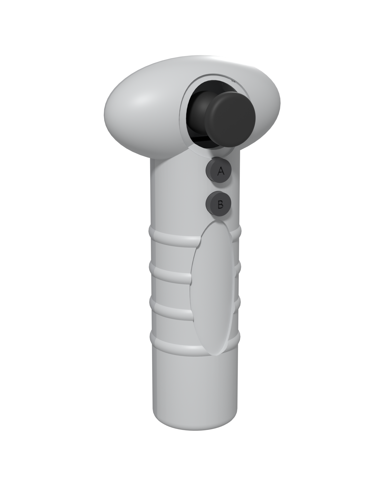
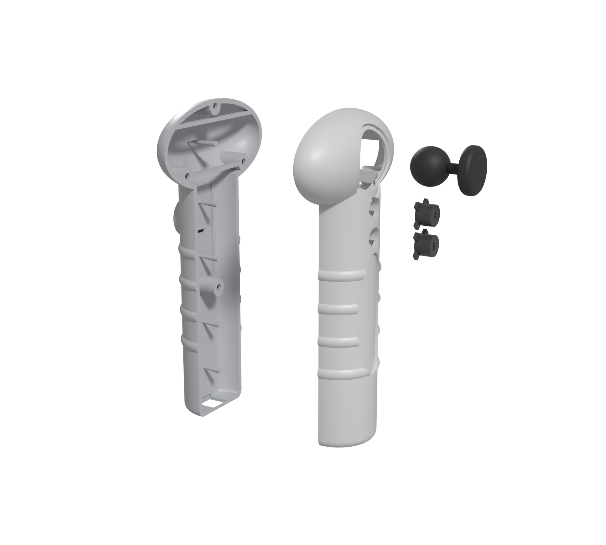

# 아라아띠 완드 컨트롤러

SSAFY 15기 특화 프로젝트 **아라아띠**(IoT 전용 컨트롤러로 즐기는 해양 테마 메타버스 협동 게임)에서 내가 맡은 임베디드 작업만 추린 저장소입니다. 손에 쥐고 휘두르는 무선 완드의 케이스, 펌웨어, Unity 입력 연동이 들어 있습니다.



| 항목 | 내용 |
|---|---|
| 기간 | 2026-08-19 ~ 2026-10-06 (7주) |
| 팀 | 6명 (클라이언트 3, 서버·인프라 1, 임베디드 2) |
| 내 역할 | 임베디드: 완드 케이스 설계, 완드·동글 펌웨어, Unity 입력 브리지, 측정 도구와 문서 |
| 사용 기술 | ESP32-S3 (Arduino C++), ESP-NOW, LSM6DS3, DRV2605L, Unity C#, Blender, PowerShell |

## 구조

```
완드 (TinyS3, ESP32-S3)
  │  ESP-NOW · 50Hz · 12바이트 패킷
  ▼
동글 (ESP32-S3 DevKit)
  │  USB 시리얼 · 115200bps · CSV
  ▼
Unity  IotPlayerController  ──▶  로비 · 낚시 · 미니게임 3종

진동은 반대 방향으로 흐릅니다: Unity ──▶ 동글 ──▶ 완드 (DRV2605L)
```

게임 PC 한 대에 동글 하나와 완드 두 대(왼손·오른손)가 붙습니다. 두 자리를 나란히 놓을 수 있도록 자리마다 Wi-Fi 채널을 나눴습니다.

## 한 일

**케이스** — Blender에서 수치로 조정하는 회전체로 설계해 v2부터 v7까지 고쳤습니다. 길이 160.5mm, 81.2g, 앞뒤 2피스에 M3×8 나사 4개로 조립하고 서포트 없이 출력합니다.

**펌웨어** — 완드는 IMU를 416Hz로 읽어 가로 베기, 세로 베기, 찌르기를 판정하고 버튼·조이스틱 상태와 함께 50Hz로 보냅니다. 보드 MAC으로 자리와 손을 정하고, 30분 동안 입력이 없으면 휴면합니다. 동글은 받은 패킷을 CSV로 바꿔 시리얼로 넘기고 진동 명령을 완드로 전달합니다.

**Unity 연동** — 시리얼을 별도 스레드에서 바이트 단위로 읽어 메인 스레드에서 해석합니다. 동글 포트를 자동으로 찾고, 완드가 없으면 키보드로 넘어갑니다. 팀원이 만든 콘텐츠 코드를 고치지 않고 붙도록 콘텐츠마다 브리지 스크립트를 따로 뒀습니다.

## 측정 결과

| 항목 | 값 | 조건 |
|---|---|---|
| 완드 동작 판정 시간 | 150 ~ 220ms → 평균 72 ~ 84ms | 판정 창이 닫힐 때가 아니라 회전이 문턱을 넘는 순간 전송하도록 바꿈. 7회 녹화 실측 |
| 휘두르기 → 화면 반응 | 약 0.26초 → 약 0.12초 | 완드 구간만 실측이고 나머지는 코드 기준 추정 |
| 찌르기를 베기로 잘못 판정 | 10회 중 7회 → 0회 | 회전 문턱 200 → 350dps |
| 수신율 | 98 ~ 99% | 자리별 채널 분리 뒤, 자리당 완드 2대 동시 10초 |

판을 바꿀 때마다 녹화한 원본 로그와 조건은 [firmware/tools/data](firmware/tools/data/README.md)에 있습니다.

## 폴더

| 경로 | 내용 |
|---|---|
| [firmware/wand_tinys3](firmware/wand_tinys3/wand_tinys3.ino) | 완드 펌웨어 |
| [firmware/dongle_esp32s3](firmware/dongle_esp32s3/dongle_esp32s3.ino) | 동글 펌웨어 |
| [firmware/tools](firmware/tools) | 동작 녹화·검증 스크립트와 측정 데이터 |
| [unity/.../Scripts/IoT](unity/UnderTheSea/Assets/Game/Scripts/IoT) | Unity 입력 브리지와 콘텐츠별 연결 스크립트 |
| [IotPlayerController.md](unity/UnderTheSea/Assets/Game/Scripts/IoT/IotPlayerController.md) | 날짜별 작업 기록: 문제, 원인, 측정, 결정 |
| [KEY_MAPPING.md](unity/UnderTheSea/Assets/Game/Scripts/IoT/KEY_MAPPING.md) | 콘텐츠별 키 배치표 |
| [exec/05_IoT완드.md](exec/05_IoT완드.md) | 포팅 매뉴얼 IoT 편: 부품, 배선, 굽는 법 |
| [case](case) | 케이스 최종 Blender 파일, 출력용 STL 4개, 렌더·정투상·치수도 |
| [case/history](case/history) | Meshy 초기안과 파라메트릭 v4의 Blender·STL, 주요 설계 변경 이력 (Git LFS) |



## 알아둘 점

- 팀 저장소에서 내 작업 경로만 그대로 옮긴 것이라 폴더 구조가 팀 저장소와 같습니다. 문서 속 링크 가운데 이 저장소에 없는 경로를 가리키는 것이 있습니다.
- Unity 스크립트는 팀 프로젝트의 다른 코드에 기대고 있어 이 저장소만으로는 빌드되지 않습니다.
- `Scripts/IoT`의 `IPlayerController.cs`, `KeyboardPlayerController.cs`, `CameraDragLook.cs`, `IotPlayerController.cs`, `KEY_MAPPING.md`에는 콘텐츠를 맡은 팀원들의 수정이 섞여 있습니다. 펌웨어, 측정 도구, 작업 기록, 포팅 매뉴얼, 케이스는 내가 작성했습니다.
